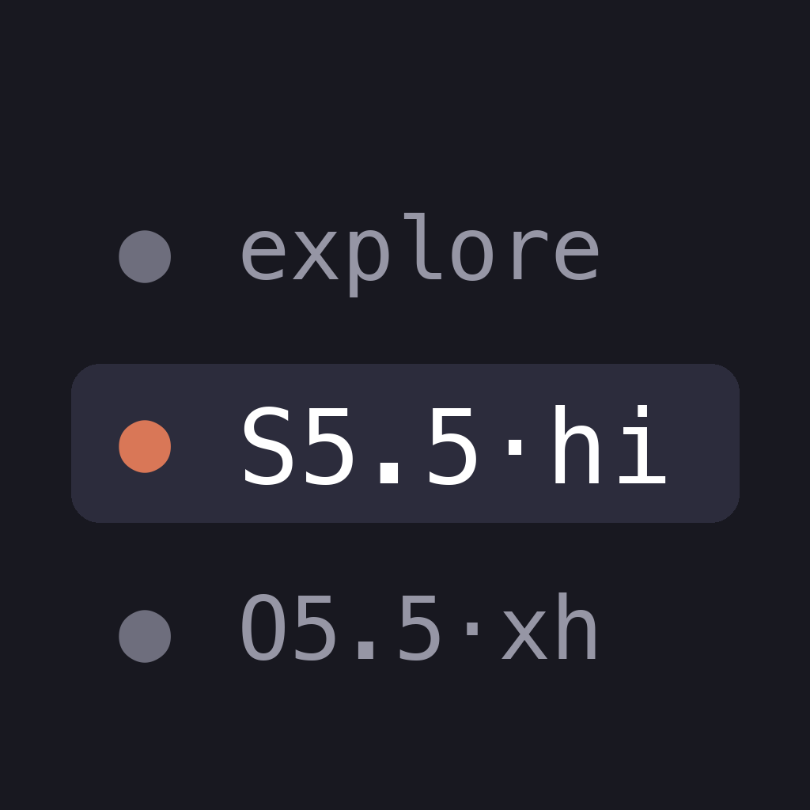

# agent-model-tag

A Claude Code mod that shows which **model** and which **effort level** each subagent is running, in a few characters on the row it already has. No new line, panel or band.

```
● S5.5·hi  Reviewing auth module
● O5.5·xh  Planning migration
● H5.5·hi  Searching call sites
```

## Reading the tag

| Part | Meaning |
| --- | --- |
| `O` `S` `H` `F` | Opus, Sonnet, Haiku, Fable |
| `5.5` | model version |
| `lo` `md` `hi` `xh` `mx` | low, medium, high, xhigh, max effort |

The effort shown is what the agent's last request actually carried, so agents that inherit the session's effort show it too. No effort part (just `S5.5`) means no effort was sent, or the agent hasn't made a request yet. Rows whose model isn't known yet are left untouched.

## Install

At the prompt of a terminal session:

```
/plugin install agent-model-tag --marketplace YoungMoneyInvestments/agent-model-tag
```

From a shell:

```
claude plugin install agent-model-tag --marketplace YoungMoneyInvestments/agent-model-tag
```

Answer `y` to add the marketplace, then pick a scope. It is active immediately and in every new session.

## Customize

The whole mod is `hooks/register.tsx`. Change the letters or abbreviations in the `FAMILY` and `EFFORT` tables at the top.

## How it works

One `ui.render` hook on the `AgentRow` component prefixes the row's `label` with the tag, built from the agent's `model` and `effort`. It touches no files, makes no network calls and keeps no state.

## License

MIT
